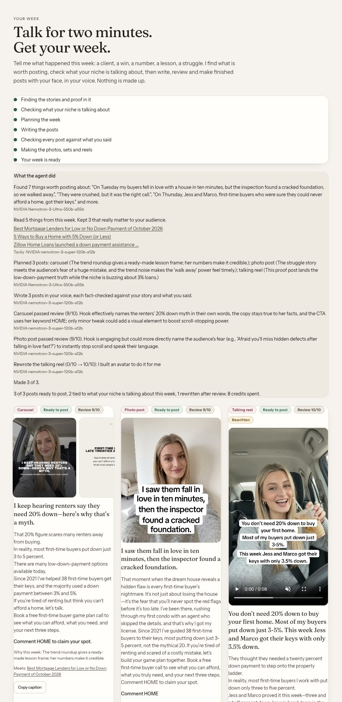
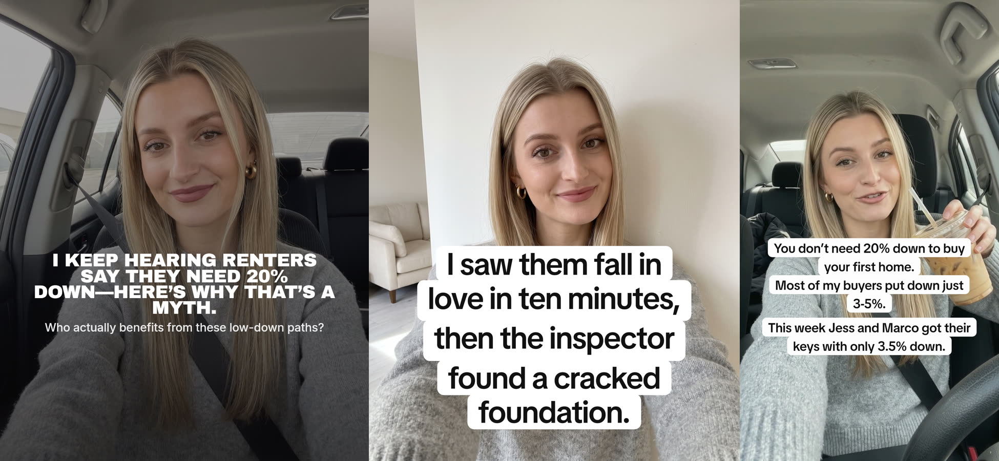

# OneTake

**Talk for two minutes. Get your week of posts — finished, in your style, with your face, and true.**

Solo founders are the whole team. They know showing up on social media grows the business, but they are also the strategist, the writer, the designer and the editor — so content is the first thing that dies, and when they go quiet the business goes quiet with them.

AI tools were supposed to fix this. Instead they handed founders more jobs: write the prompts, pick the models, pay for five subscriptions, stitch a caption from one tool onto an image from another, fix the face that isn't quite yours, delete the claim you never made. They give you *pieces*. OneTake gives you *posts*.


## What it does

1. **You talk about your week** — a voice note or a few typed sentences: a client win, a number, a lesson, a struggle.
2. **OneTake's agent takes it from there**, and you watch every step on a live timeline:
   - **Understands** what actually happened, keeping your words where they carry the point (NVIDIA Nemotron 3 Ultra).
   - **Researches** what your audience is reading and discussing *this week* (Tavily), then throws out anything that doesn't really matter to them (Nemotron 3 Super) — a trend is only used when it genuinely fits.
   - **Plans** up to three posts — a talking reel, a carousel, a photo post — each standing on something real you said, joined to a trend only where it genuinely fits, inside the credit budget you agreed to (Nemotron 3 Ultra).
   - **Writes** each post in your voice with a fact-check that only allows your story, your proof points and what you said this week (Nemotron 3 Super).
   - **Reviews its own work** like an editor: hook strength, sounds-like-you, and every claim against your words. Anything that fails is rewritten once and the better of the two drafts is kept; a post that still fails is **held back and nothing is spent on it**. The timeline tells you what changed and why (Nemotron 3 Super).
   - **Only then spends credits** making the reel, the slides and the photo — with your face, from your own reference photos.
3. **You get one page:** finished posts to download, captions to copy, why each post this week, and what the agent changed. Nothing is posted for you; you stay in control of what goes out.



*A real run for Sarah, a made-up real estate agent: Nemotron Ultra found her stories, Tavily and Nemotron Super kept the trends that matter to first-time buyers, Ultra planned three posts, Super wrote and reviewed them, caught a line she never said in the reel and rewrote it, and only then were the posts made.*



There is also a **Create** chat for one-off posts ("make me a carousel about my pricing mistake"), driven by a Nemotron 3 Super tool-calling agent.

## How it uses NVIDIA Nemotron and Nebius Token Factory

Every call that thinks or writes runs on **NVIDIA Nemotron through Nebius Token Factory**, sized to the job — the three-tier routing the models were designed for:

| Model (Token Factory id) | Job in OneTake | Why this size |
|---|---|---|
| `nvidia/Nemotron-3-Ultra-550b-a55b` | Reading your week into facts; planning the week | The few calls where depth of reasoning *is* the product |
| `nvidia/nemotron-3-super-120b-a12b` | Writing every hook, caption and spoken line; the fact-check; the critic that reviews every post; judging which of this week's search results matter; the Create agent's tool calls | Judgment, her voice and reliable tool calling, fast enough for a live chat |
| `nvidia/NVIDIA-Nemotron-3-Nano-30B-A3B` | Fast everyday calls: scene ideas for a set of photos, the words drawn on a photo, motion ideas for a clip, choosing a library clip | Cheap and quick where a person or a later step checks the result |

- **One routing point:** `src/ai/text.ts` sends words to Nemotron and anything with pictures to a vision model. `routeText` is a pure function with tests.
- **Client:** `src/ai/nemotron.ts` speaks Token Factory's OpenAI-compatible API: JSON-schema answers, streamed tool-calling turns converted to and from the agent's thread format, and Nemotron's `<think>` reasoning stripped so it never reaches the screen.
- **The agent:** `src/week/` — `plan.ts` (pure: prompts, validation of every model answer, the budget), `step.ts` (one stage per poll under a lease, so it survives a closed tab and never does a stage twice), `view.ts` (an allow-list of what the browser sees).
- **Why Token Factory accelerated the work:** one OpenAI-compatible endpoint for all three Nemotron sizes meant the whole app could be moved onto open models by changing one routing function, and the per-tier latency (about 1–2 seconds for Nano, Super and Ultra on short calls in our tests) let a five-model-call review loop run inside a normal page poll.
- **Resilience:** if a Nemotron call fails, the same call is retried on a fallback model so a founder never loses a post to one provider's bad minute; the log records it.

Other services: **Tavily** (this week's news in her niche, with links shown to her), **Gemini** (photos of her from her own reference photos, talking-reel video, and reading pictures and voice notes — Nemotron's text models cannot see or hear), **Clerk** (accounts), **Neon Postgres** (data), **Vercel Blob** (private media), **Vercel** (hosting and the every-minute sweep that keeps a week moving).

## Honest by design

- The writer may only use her story, her proof points and what she said this week. Numbers are never invented; a reviewer checks every claim before anything is made.
- Paid work reserves credits before it runs and refunds on failure; a retried request never charges twice (a client request id, enforced by a unique index).
- Every row carries the account's user id and every query filters on it; media is private and served only through an owner check.
- New accounts get a fixed number of free credits. There is no way to buy more in this build.

## Run it yourself

Requirements: Node 22+, pnpm, a Postgres database (Neon works), and keys for Token Factory, Tavily, Gemini and Clerk.

```bash
pnpm install
cp .env.example .env.local      # fill in the keys; names only are in the example
pnpm db:migrate                 # creates the tables
pnpm dev                        # http://localhost:3000
```

Locally, media is stored on the filesystem; hosted, connect a private Vercel Blob store and it is used automatically.

Checks: `pnpm exec tsc --noEmit`, `pnpm exec eslint src scripts --max-warnings 0`, `pnpm test` (node:test through tsx; the model clients are tested with fake responses, no network).

## Try it

1. Sign up, upload a few photos of yourself, and fill in your brand (niche, audience, offer, voice).
2. Open **Your week**, record or type what happened this week, and press **Make my week**. It shows the price before you press.
3. Watch the timeline; the posts appear as they are made, usually in five to ten minutes.

## License

[AGPL-3.0](LICENSE). You may use, study and change this code; if you run a modified version as a service, you must publish your changes under the same license.
